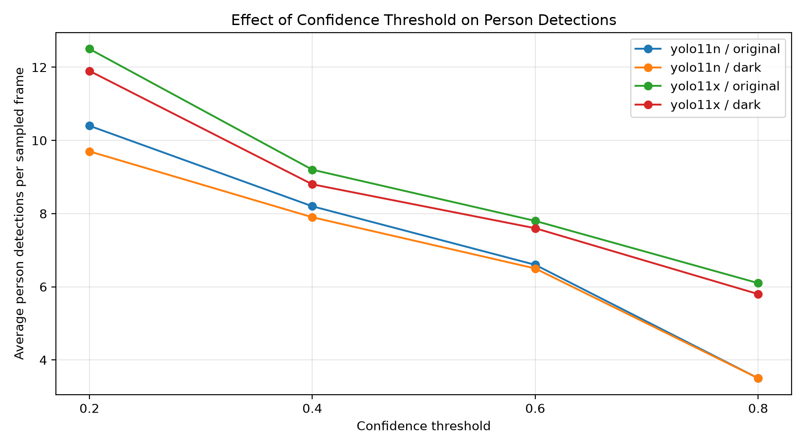
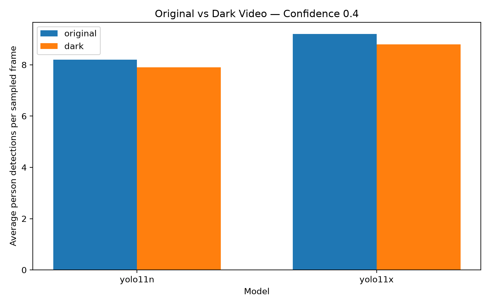
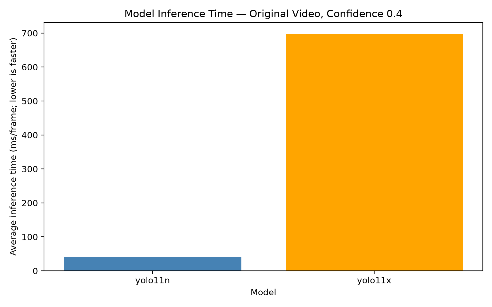

# YOLO Video Comparison

This project compares YOLO11n and YOLO11x for person detection using one video.
It tests original and darkened frames at four confidence thresholds.
Results are saved as CSV files, annotated images, and matplotlib charts.

## Experiment Setup

- Sampled frames: 10, approximately one frame per second
- Models: yolo11n and yolo11x
- Conditions: original and darkened to 40% brightness
- Confidence thresholds: 0.2, 0.4, 0.6, 0.8
- Detection class: person
- Device: CPU
- YOLO image size: 640

The same sampled frames and settings were used for both models.

## Detection Results

Values show average person detections per sampled frame.

| Confidence | YOLO11n Original | YOLO11n Dark | YOLO11x Original | YOLO11x Dark |
|---|---:|---:|---:|---:|
| 0.2 | 10.4 | 9.7 | 12.5 | 11.9 |
| 0.4 | 8.2 | 7.9 | 9.2 | 8.8 |
| 0.6 | 6.6 | 6.5 | 7.8 | 7.6 |
| 0.8 | 3.5 | 3.5 | 6.1 | 5.8 |

## Speed Comparison

Original frames at confidence 0.4:

| Model | Average Inference Time |
|---|---:|
| YOLO11n | 41.70 ms/frame |
| YOLO11x | 696.87 ms/frame |

YOLO11x took approximately 16.7 times as long as YOLO11n
for model inference in this experiment.
These timings exclude video loading and saving.

## Findings

- Higher confidence thresholds reduced the number of detections.
- Darkening slightly reduced detections in most experiments.
- YOLO11x produced more detections at every tested threshold.
- YOLO11n had much lower inference time on this computer.

Detection counts are not accuracy scores or unique person counts.
The same person may appear in multiple frames.
Without manually labelled ground truth, this experiment cannot
determine which model is more accurate.

## Charts

### Confidence Comparison


### Original vs Dark


### Model Speed


## How to Run

Python 3.13 was used for this project.

1. Install dependencies:

   ```bash
   python -m pip install -r requirements.txt
   ```

2. Place a video containing people in the project folder
   and name it `input.mp4`.

3. Run all experiments:

   ```bash
   python compare.py
   ```

4. To regenerate charts from the saved summary:

   ```bash
   python plot_results.py
   ```

Model weights download automatically on first use.
The input video and model weights are excluded from this repository.

## Files

- `compare.py`: runs the experiments and generates results
- `plot_results.py`: generates charts from saved results
- `results/`: charts, CSV measurements, and annotated examples
- `requirements.txt`: Python dependencies